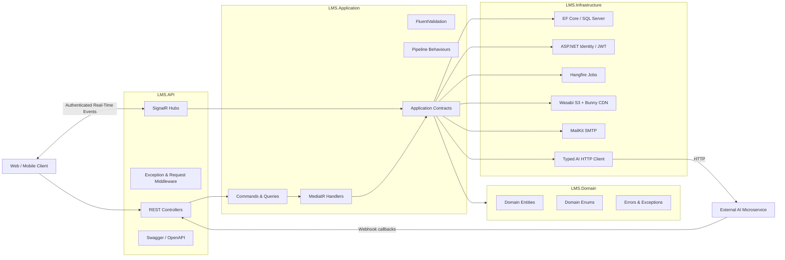

# AiLern — AI-Enhanced Learning Management System

[](https://dotnet.microsoft.com/)
[](https://learn.microsoft.com/aspnet/core/)
[](https://learn.microsoft.com/sql/)
[](LICENSE)

**AiLern** is a backend learning management platform that integrates artificial intelligence directly into the teaching and learning workflow. The system supports course delivery, enrollment and progress tracking, timed assessments, assignments, discussions, notifications, dashboards, and AI-assisted quiz generation and grading.

The AI service is isolated behind a typed HTTP integration and webhook callbacks. This keeps AI operations asynchronous while the LMS continues to provide reliable status updates and real-time feedback to clients.

---

## Table of Contents

- [Key Features](#key-features)
- [System Architecture](#system-architecture)
- [Architectural Patterns](#architectural-patterns)
- [Infrastructure Services](#infrastructure-services)
- [Background Jobs](#background-jobs)
- [Logging and Observability](#logging-and-observability)
- [Project Structure](#project-structure)
- [API and Real-Time Endpoints](#api-and-real-time-endpoints)
- [Technology Stack](#technology-stack)
- [Getting Started](#getting-started)
- [Configuration](#configuration)
- [Database](#database)
- [Demo](#demo)
- [License](#license)

---

## Key Features

### Courses and Learning Delivery

- Create, update, publish, and manage courses.
- Organize courses into ordered sections and learning materials.
- Enroll students and track course and section progress.
- Upload and serve course images, documents, and assignment files.
- Generate signed storage URLs for direct, time-limited uploads and downloads.

### Quizzes and Attempts

- Create quizzes with configurable availability and time limits.
- Support multiple question types and shuffled questions/options.
- Create and resume student attempts.
- Prevent quiz access while an active attempt is in progress.
- Automatically submit attempts when their time window expires.
- Calculate scores and expose dashboards and student results.

### AI Quiz Generation

- Submit quiz criteria and course resources to an external AI service.
- Generate questions asynchronously through a background workflow.
- Review pending AI-generated questions.
- Accept, reject, or evaluate individual questions.
- Accept all generated questions for a quiz in one operation.
- Update AI grading criteria and monitor generation status.

### AI-Assisted Grading

- Grade quiz attempts in batches through a dedicated AI job.
- Receive per-answer confidence values and grading feedback.
- Maintain AI grading status and evaluation records.
- Identify weak topics and return targeted feedback to students.
- Process AI grading callbacks through dedicated webhook endpoints.

### Assignments and Submissions

- Create assignments with instructions, deadlines, and file attachments.
- Use a two-step submission upload flow:
  1. Request a signed upload URL.
  2. Upload the file and confirm it with the API.
- Allow instructors to review, grade, and manage submissions.
- Track submission status and submission files.

### Collaboration and Reporting

- Create and reply to course discussions.
- Upvote, downvote, pin, and unpin discussions.
- Report inappropriate or incorrect learning materials.
- Approve or reject reports through administrative workflows.
- Display report statistics and instructor/course dashboards.

### Identity and Access

- ASP.NET Core Identity integration.
- JWT bearer authentication with issuer, audience, and lifetime validation.
- Rotating refresh tokens.
- Email confirmation, password reset, and email-change confirmation.
- Role-based access for **Admin**, **Instructor**, and **Student** users.
- Administrative user management and role-aware authorization.

### Notifications

- Persistent in-app notifications.
- SignalR real-time notification delivery.
- Course-based notification groups for enrolled students.
- HTML email notifications for account and course events.
- Bulk email jobs for notification workflows.

---

## System Architecture

AiLern follows Clean Architecture. Dependencies point inward: the API and Infrastructure depend on Application, while Application and Infrastructure depend on Domain contracts and models. The Domain and Application layers remain independent of framework-specific infrastructure.



### Dependency Flow

| Layer | Responsibility |
|---|---|
| **LMS.API** | HTTP controllers, middleware, Swagger, CORS, SignalR hubs, webhook receiver |
| **LMS.Application** | Use cases, CQRS handlers, validators, DTOs, mappings, pipeline behaviours, contracts |
| **LMS.Domain** | Core entities, enums, domain errors, constants, and domain exceptions |
| **LMS.Infrastructure** | EF Core and SQL Server, Identity, JWT, storage, SMTP, Hangfire, AI client, webhooks, and SignalR |

---

## Architectural Patterns

### CQRS and MediatR

Write operations are implemented as commands and read operations as queries. MediatR dispatches both to dedicated handlers, keeping controllers thin and use cases isolated.

### Pipeline Behaviours

The MediatR pipeline includes:

1. **Block access during quiz** — enforces quiz access rules before protected attempt operations.
2. **Logging** — logs request handling and success, validation failure, or domain/application failure.
3. **Validation** — runs FluentValidation validators before handlers execute.

### Result Pattern

Use-case operations use a result model containing success, error, and validation information. This avoids exception-driven control flow for expected validation and business outcomes.

### Repository and Unit of Work

Repositories provide feature-specific persistence operations and shared EF-backed querying. `IUnitOfWork` coordinates repositories and transaction commits across application operations.

### Generic Repository

`IBaseRepository<T>` and `BaseRepository<T>` provide common CRUD and query operations while specialized repositories extend the persistence API for domain-specific use cases.

### Dependency Inversion

Infrastructure implementations are accessed through application contracts such as:

- Repositories
- `IAIService`
- `IWasabiService`
- `IEmailSender`
- `INotificationService`
- `IJwtTokenService`
- `IRefreshTokenService`
- `IBackgroundJobService`

### External-Client and Webhook Integration

A named typed `HttpClient` communicates with the external AI service. Webhook settings and callback controllers process asynchronous AI status changes and results.

---

## Infrastructure Services

| Service | Implementation | Purpose |
|---|---|---|
| **Database** | SQL Server with EF Core 9 | Relational persistence and code-first migrations |
| **Identity** | ASP.NET Core Identity | Users, roles, password rules, email confirmation, tokens |
| **Authentication** | JWT bearer authentication | Stateless API authorization |
| **Refresh sessions** | `RefreshToken` entity + rotating token service | Extended user sessions |
| **Object storage** | AWS S3 SDK against Wasabi S3-compatible storage | Private/public course and submission files |
| **CDN delivery** | Bunny CDN | Signed and public file URLs |
| **Background processing** | Hangfire with SQL Server storage | Durable jobs and scheduling |
| **Real-time communication** | ASP.NET Core SignalR | Notifications and AI-resource status updates |
| **Email** | MailKit + SMTP + HTML templates | Welcome, confirmation, reset, change-email, and notification emails |
| **AI integration** | Typed named `HttpClient` | Quiz generation and batch grading |
| **Webhook callbacks** | ASP.NET Core controller endpoints | Asynchronous AI job completion and status updates |
| **Logging** | Serilog | Structured application and HTTP logging |
| **API documentation** | Swagger/Swashbuckle + annotations | OpenAPI specification and interactive UI |
| **Validation** | FluentValidation | Command and query validation |
| **Object mapping** | AutoMapper | Entity/DTO mapping |
| **Global errors** | Custom exception middleware | Consistent API error responses |

---

## Background Jobs

Hangfire executes long-running and scheduled work outside the request pipeline:

| Job | Responsibility |
|---|---|
| `AIBatchGradingJob` | Processes quiz attempt answers through the external AI grading service |
| `AutoSubmitAttemptJob` | Automatically submits expired quiz attempts |
| `CalculateStudentScoreJob` | Recalculates a student's quiz or course-related score |
| `ConfirmUploadedFilesJob` | Confirms that uploaded course, section, assignment, or submission files exist |
| `PrepareDocumentsForAIJob` | Prepares course documents for AI-powered retrieval and question answering |
| `RemoveExpiredRefreshTokensJob` | Runs daily and removes expired refresh tokens |
| `SendEmailToUsersJob` | Sends bulk notification emails |
| `HangfireJobService` | Centralizes scheduling and Hangfire job operations |

The Hangfire dashboard is available in Development at `/hangfire`.

---

## Logging and Observability

Serilog is configured from `appsettings.*.json` and added to the ASP.NET Core host.

- **Console sink** — human-readable development logs.
- **Rolling file sink** — structured JSON logs under `Logs/`.
- **Log context enrichment** — machine, environment, thread, and process information.
- **Request logging** — request timing and HTTP status telemetry.
- **EF Core SQL logs** — database commands are included at the Information level.
- **MediatR pipeline logs** — request handling, success, validation, and application errors.
- **Infrastructure logs** — storage, SMTP, AI, and background job operations log context-specific details.
- **Seq dependency** — `Serilog.Sinks.Seq` is included for optional central log collection when a Seq sink is added to configuration.

Example log paths:

- Development: `Logs/log-*.txt`
- Production: `Logs/log-*.json`

---

## Project Structure

```text
AiLern/
├── src/
│   ├── LMS.API/
│   │   ├── Controllers/       REST endpoints and AI webhook receiver
│   │   ├── Extensions/        HTTP, CORS, Swagger, and startup configuration
│   │   ├── Middleware/        Global exception handling
│   │   ├── Models/            API-specific request and response models
│   │   └── wwwroot/
│   │       └── EmailTemplates/HTML email templates
│   │
│   ├── LMS.Application/
│   │   ├── Features/         Commands, queries, handlers, validators, and DTOs
│   │   ├── Common/           Pipeline behaviours and shared result types
│   │   ├── Contracts/        Repository and infrastructure abstractions
│   │   └── DependencyInjection.cs
│   │
│   ├── LMS.Domain/
│   │   ├── Entities/         Core domain entities
│   │   ├── Enums/           Domain status and option types
│   │   ├── Exceptions/      Domain-specific exceptions
│   │   └── Constants/       Role and sorting constants
│   │
│   └── LMS.Infrastructure/
│       ├── Persistence/      DbContext, configurations, migrations, repositories
│       ├── Services/         Identity, JWT, email, storage, and notification services
│       ├── Jobs/             Hangfire background job implementations
│       ├── ExternalServices/ Typed external AI client
│       ├── Hubs/             SignalR hubs
│       └── Settings/         Strongly typed options
│
└── tests/
    └── LMS.Infrastructure.Tests/
```

---

## API and Real-Time Endpoints

The API is organized around domain-oriented controllers:

| Area | Examples |
|---|---|
| Authentication | Registration, login, refresh, revoke, email confirmation, password reset |
| Courses | Course CRUD, enrollments, progress, AI resources |
| Sections | Section management and material upload/confirmation |
| Quizzes | Quiz CRUD, question management, AI generation, grading criteria |
| Attempts | Start, save, submit, grade, and retrieve quiz attempts |
| Assignments | Assignment CRUD and file management |
| Submissions | Upload, confirm, grade, and retrieve submissions |
| Discussions | Create, answer, vote, pin, and manage course discussions |
| Dashboards | Admin, instructor, course, quiz, and reporting dashboards |
| Notifications | Read, delete, and mark notifications |
| Reports | Create, review, approve, reject, and report statistics |
| AI Webhooks | Receive external AI callbacks |

Swagger UI is enabled for Development environments.

### SignalR Hubs

| Hub | Route | Purpose |
|---|---|---|
| `NotificationHub` | `/notificationHub` | In-app notifications and course notifications |
| `AIServiceHub` | `/hubs/ai-resources` | AI resource preparation and status updates |

Both hubs require JWT authorization.

---

## Technology Stack

| Category | Technology |
|---|---|
| Runtime | .NET 9 |
| API | ASP.NET Core Web API |
| Architecture | Clean Architecture |
| Use Cases | MediatR CQRS |
| Validation | FluentValidation |
| Mapping | AutoMapper |
| Persistence | Entity Framework Core 9, SQL Server |
| Authentication | ASP.NET Core Identity, JWT Bearer |
| Background Jobs | Hangfire + Hangfire.SqlServer |
| Real-Time | ASP.NET Core SignalR |
| Storage | AWS S3 SDK + Wasabi S3-compatible object storage |
| CDN | Bunny CDN |
| Email | MailKit |
| Logging | Serilog, Console/File sinks, optional Seq |
| API Docs | Swagger / Swashbuckle |
| AI Integration | Named typed `HttpClient` |

---

## Getting Started

### Prerequisites

- [.NET 9 SDK](https://dotnet.microsoft.com/download/dotnet/9.0)
- SQL Server instance
- SMTP account for email delivery
- Wasabi S3-compatible storage credentials
- Bunny CDN configuration
- External AI service URL

### 1. Clone the Repository

```bash
git clone https://github.com/MazenElnems/AiLern.git
cd AiLern
```

### 2. Configure the Application

Create Development configuration using user secrets or environment variables. Do not commit real credentials.

```bash
dotnet user-secrets init --project src/LMS.API
```

### 3. Restore and Build

```bash
dotnet restore AiLernSystem.slnx
dotnet build AiLernSystem.slnx
```

### 4. Apply EF Core Migrations

```bash
dotnet ef database update \
  --project src/LMS.Infrastructure \
  --startup-project src/LMS.API
```

On Windows PowerShell, use a single line or a backtick continuation instead of `\`.

### 5. Run the API

```bash
dotnet run --project src/LMS.API
```

Open Swagger in a Development environment at:

```text
https://localhost:<port>/swagger
```

The Hangfire dashboard is available at:

```text
https://localhost:<port>/hangfire
```

---

## Configuration

The application binds the following configuration sections:

| Section | Example fields |
|---|---|
| `ConnectionStrings:DefaultConnection` | SQL Server connection string |
| `JWT` | `Key`, `Issuer`, `Audience`, `DurationInMinutes` |
| `RefreshTokenOptions` | `DurationInDays` |
| `AIServiceSettings` | `BaseUrl`, upload/delete/Q&A/batch-grading endpoints |
| `WebhookSettings` | Webhook base URL and endpoint map |
| `Wasabi` | Access key, secret key, buckets, region, service URL |
| `BunnyCDN` | Signing token, base URL, public URL |
| `EmailSettings` | SMTP server, port, sender, and app password |
| `FrontEndSettings` | Frontend domain used in email links |
| `Serilog` | Sinks, levels, enrichers, and rolling log settings |

### Example Configuration Shape

```json
{
  "ConnectionStrings": {
    "DefaultConnection": "Server=localhost;Database=AiLern;Trusted_Connection=True;TrustServerCertificate=True"
  },
  "JWT": {
    "Key": "<strong-secret-key>",
    "Issuer": "AiLern",
    "Audience": "AiLern-Client",
    "DurationInMinutes": 60
  },
  "RefreshTokenOptions": {
    "DurationInDays": 7
  },
  "AIServiceSettings": {
    "BaseUrl": "https://ai.example.com",
    "QAEndpoint": "/qa",
    "UploadEndpoint": "/upload",
    "DeleteEndpoint": "/delete",
    "CancelJobEndpoint": "/jobs/cancel",
    "BatchGradingEndpoint": "/grading/batch"
  },
  "Wasabi": {
    "AccessKey": "<access-key>",
    "SecretKey": "<secret-key>",
    "BucketName": "<private-bucket>",
    "ContentBucketName": "<public-content-bucket>",
    "Region": "<region>",
    "ServiceURL": "https://s3.<region>.wasabisys.com"
  },
  "BunnyCDN": {
    "Token": "<signing-token>",
    "BaseUrl": "https://cdn.example.com",
    "PublicUrl": "https://cdn.example.com"
  },
  "EmailSettings": {
    "SmtpServer": "smtp.example.com",
    "SmtpPort": 587,
    "FromEmail": "noreply@example.com",
    "FromName": "AiLern",
    "AppPassword": "<smtp-password>"
  },
  "FrontEndSettings": {
    "Domain": "https://app.example.com/"
  }
}
```

> Use environment variables or user secrets in Development and a managed secret provider in Production.

---

## Database

The persistence layer uses EF Core code-first migrations and Fluent entity configurations in `LMS.Infrastructure/Persistence/Configurations`.

At startup, `InitializeDatabaseAsync()` initializes the database through the Infrastructure database initializer.

The data model includes courses, sections, materials, enrollments, progress, quizzes, questions, options, attempts, answers, assignments, submissions, discussions, reports, notifications, AI resources, AI grading criteria, weak topics, refresh tokens, and Identity entities.

---

## Demo

Demo videos for AI grading, AI-powered Q&A, and the system architecture are available in:

- [AiLern-Demo](https://github.com/MazenElnems/AiLern-Demo)

---

## License

This project is distributed under the MIT License. See [LICENSE](LICENSE) for details.
